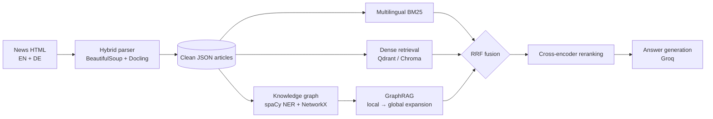

# Graph-Based Hybrid RAG for Multilingual News

Hybrid retrieval and question answering over the **ETH Zurich news archive** (English and German).
Three retrievers, **multilingual BM25**, **dense vectors** (Qdrant / Chroma) and **GraphRAG** over a knowledge
graph of people, organisations and topics, are fused with Reciprocal Rank Fusion, reranked by cross-encoders,
and passed to an LLM (Groq) that writes the answer.



## Features

- **Article extraction** — BeautifulSoup and Docling combined to pull clean main text and structure from HTML news pages.
- **Multilingual BM25** — query language detection, EN ↔ DE query translation, per-language NLTK preprocessing.
- **Dense retrieval** — Sentence-Transformers embeddings (`all-MiniLM-L6-v2`) in Qdrant or Chroma.
- **GraphRAG** — knowledge graph built from spaCy entities (EN and DE models) with `contains`, `co-occurs`,
  `temporal` and `shared_topic` edges; retrieval seeds articles with `multilingual-e5-large` similarity and
  expands up to two hops through shared entities and topics.
- **Hybrid fusion** — Reciprocal Rank Fusion (k = 60) or weighted score fusion.
- **Multi-model reranking** — TinyBERT, MiniLM and BGE cross-encoders, an ensemble of all three, keyword boost,
  optional Cohere.
- **Answer generation** — fast LLM answers via Groq over the reranked context.
- **Evaluation** — Precision@k, Recall@k and MRR; GraphRAG compared with the other retrievers and the hybrid.

## Repository structure

```
graph_based_rag_recsys/
├── hybrid_retrieval/
│   ├── multilingual_bm25/   # BM25 with language detection and query translation
│   ├── graphrag/            # entity extraction, graph building, GraphRAG retriever, evaluation, visualiser
│   ├── adapters/            # BM25 / dense / GraphRAG behind one interface
│   ├── score_fusion.py      # RRF and weighted fusion
│   ├── reranking.py         # cross-encoder and ensemble reranking
│   └── hybrid_retriever.py  # orchestrator: retrieve → fuse → rerank
├── scripts/
│   ├── few_hybrid_parsing.py    # HTML → clean text (BeautifulSoup + Docling)
│   ├── ingest_dense.py          # embed articles into Qdrant
│   ├── build_graphrag.py        # build the knowledge graph
│   ├── test_dense_query.py      # try the dense retriever
│   └── generate_answers_groq.py # answer the benchmark questions with Groq
├── benchmark/               # ETH QA benchmark, sample German articles, query results
├── data/documents/          # sample articles (JSON)
├── docker/                  # Qdrant docker-compose
├── agents/                  # notebooks for agent experiments
├── requirements.txt
└── requirements_min.txt     # BM25 + graph only
```

Each article is one JSON file: `language`, `title`, `date`, `source`, `main_content`, `summary`, `keywords`, `topics`.

## Quickstart

```bash
# 1. Clone and create an environment
git clone https://github.com/asainov1/graph_based_rag_recsys.git
cd graph_based_rag_recsys
python3 -m venv .venv && source .venv/bin/activate

# 2. Install dependencies
pip install -r requirements.txt
pip install spacy qdrant-client docling beautifulsoup4 pyvis
python -m spacy download en_core_web_sm
python -m spacy download de_core_news_sm

# 3. Start Qdrant
docker compose -f docker/qdrant-docker-compose.yml up -d

# 4. Index the articles and build the graph
python scripts/ingest_dense.py
python scripts/build_graphrag.py

# 5. Run hybrid retrieval
python -m hybrid_retrieval.test_hybrid
python scripts/test_dense_query.py

# 6. Generate answers with Groq
export GROQ_API_KEY=...
python scripts/generate_answers_groq.py
```

## Benchmarking

`benchmark/eth_benchmark_qa.json` contains 25 questions about ETH Zurich history, each with a hint and a reference
answer. `scripts/generate_answers_groq.py` retrieves context, generates answers and compares them with the
references; `hybrid_retrieval/graphrag/evaluation.py` and `compare_retrievers.py` report Precision@k, Recall@k
and MRR per retriever.

## Reranking

| Method | Model | Use |
|---|---|---|
| `tinybert` | `cross-encoder/ms-marco-TinyBERT-L-2-v2` | fastest |
| `minilm` | `cross-encoder/ms-marco-MiniLM-L-6-v2` | balanced |
| `bge` | `BAAI/bge-reranker-base` | most accurate |
| `ensemble` | all three, rank-level fusion | most robust |

Rerankers reorder the fused top results by scoring each (query, passage) pair with a cross-encoder.

## Roadmap

- nDCG and a larger benchmark with multi-hop questions
- Typed relations from an LLM extractor (e.g. *president of*, *founded in*) instead of co-occurrence only
- Iterative retrieval / question decomposition for multi-hop questions
- LangGraph-based agent orchestration
- Streamlit demo UI

## License

MIT © 2025 Alikhan Sainov

## Acknowledgements

Built as a team project; hybrid HTML parser by Daria.
Thanks to [Qdrant](https://qdrant.tech), [Sentence-Transformers](https://www.sbert.net), [spaCy](https://spacy.io),
[NetworkX](https://networkx.org), [Docling](https://github.com/docling-project/docling) and [Groq](https://groq.com).
Example articles come from ETH Zurich news.
